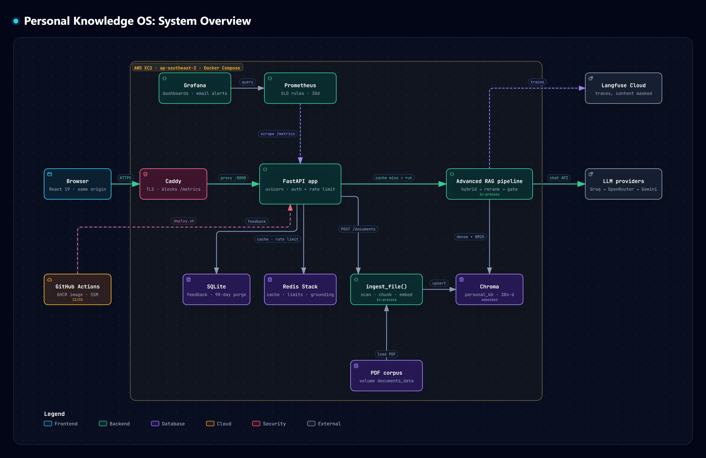
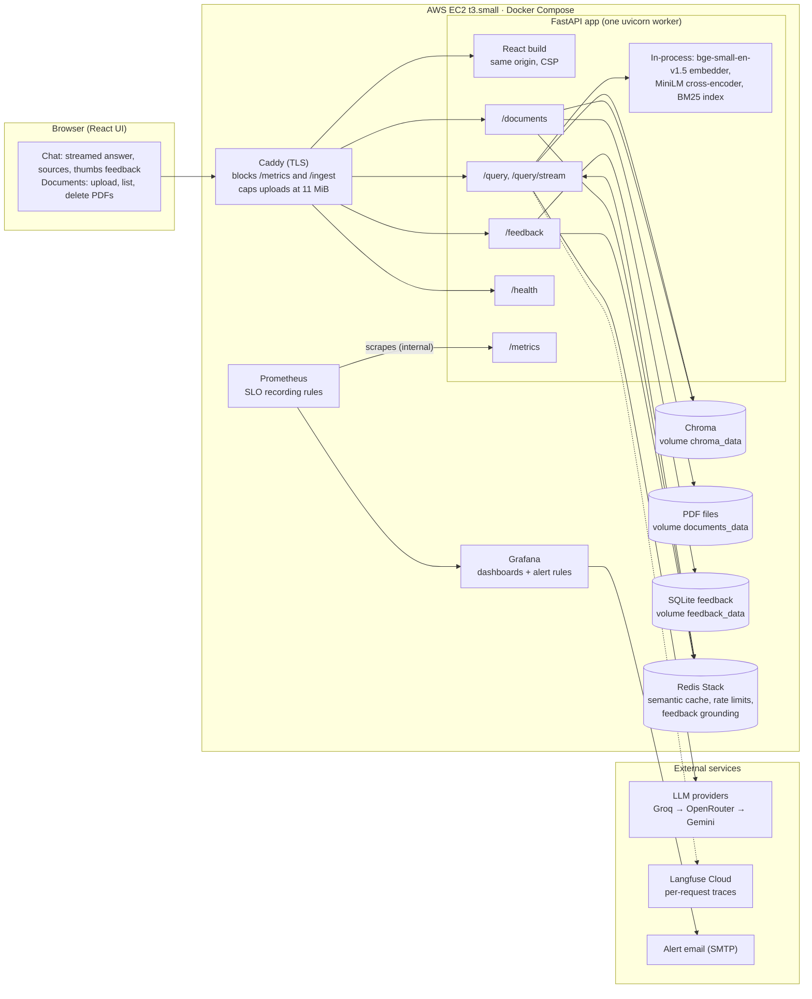
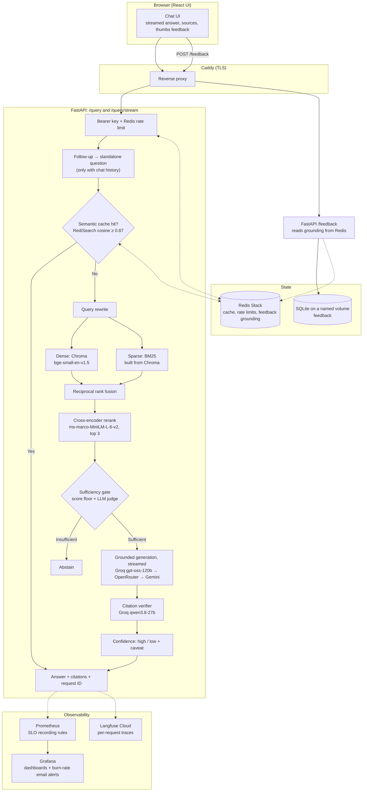
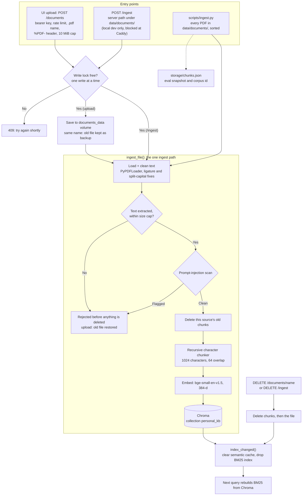
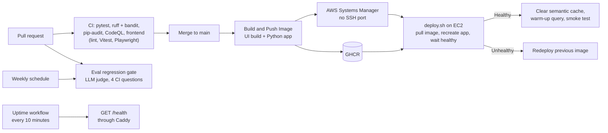

# Architecture

How Personal Knowledge OS is built: the whole system, the query and ingestion pipelines, delivery, and the design decisions behind them.

**Contents:** [System overview](#system-overview) · [Query pipeline](#query-pipeline) · [Ingestion pipeline](#ingestion-pipeline) · [Delivery and operations](#delivery-and-operations) · [Components](#components) · [State and storage](#state-and-storage) · [Design decisions](#design-decisions) · [Configuration defaults](#configuration-defaults) · [Repository layout](#repository-layout) · [Known limitations](#known-limitations)

---

## System overview

Everything runs on one EC2 instance in Docker Compose. Chroma, BM25 and both local models run inside the app process; only the LLMs, Langfuse and alert email are external.



Interactive version, with each box linked to its source lines: [system-overview.html](docs/architecture/system-overview.html) (download and open in a browser). Built with archify from [system-overview.archify.json](docs/architecture/system-overview.archify.json).



## Query pipeline

`src/pipeline/advanced_rag.py`, served by `api/routers/query.py`.



## Ingestion pipeline

Since Phase 15.0 every write goes through one function, `ingest_file()` (`rag-project/src/ingestion/ingest.py`), so Chroma, BM25 and the cache cannot drift apart.



The loader also reads Markdown, DOCX and TXT, but the API and the batch script accept PDFs only (the corpus is PDF only, decided 2026-10-31). On first start in production, an empty `chroma_data` volume is seeded from the index built into the image; after that the volume is the source of truth.

## Delivery and operations

Details in [OPERATIONS.md](OPERATIONS.md).



---

## Components

### Retrieval and answer quality

| Stage | Module | What it does |
| --- | --- | --- |
| Condense | `src/pipeline/query_rewriter.py` | With chat history (up to 5 turns), rewrites a follow-up ("what about the SUV?") into a standalone question before the cache and retrieval see it. History is untrusted and used only in this prompt. |
| Semantic cache | `src/llm/semantic_cache.py` | RediSearch vector lookup, cosine ≥ 0.87, 24 h TTL. Namespaced by prompt version and model, so a prompt or model change never serves an old answer. A hit also needs the same content words in the same order, so `car loan` never matches `bike loan`. |
| Rewrite | `src/pipeline/query_rewriter.py` | LLM rewrite of the question for retrieval. |
| Dense | `src/retrieval/retriever.py` | Chroma HNSW over `BAAI/bge-small-en-v1.5` (384-d) embeddings. Default HNSW parameters, confirmed identical to exact search in Phase 15.2. |
| Sparse | `src/retrieval/bm25_retriever.py` | In-memory BM25 built from the chunks Chroma stores; dropped after every write and rebuilt on the next query (about 0.4 s at 2,221 chunks, measured in 15.1; the corpus is 1,295 chunks at 1024/64). |
| Fusion | `src/retrieval/fusion.py` | Reciprocal rank fusion (k = 60) of the dense and sparse lists. |
| Rerank | `src/retrieval/reranker.py` | `cross-encoder/ms-marco-MiniLM-L-6-v2`, top 3 of 6 (`TOP_K` 3, rerank input `TOP_K × 2`). |
| Sufficiency gate | `src/pipeline/context_sufficiency.py` | Cross-encoder score floor, then an LLM judge. Abstains before generation when the evidence is missing. |
| Generation | `src/llm/client.py` | Grounded answer citing `[SOURCE N]`, streamed. Retry and fallback Groq → OpenRouter → Gemini (Ollama locally); on the stream, fallback happens only before the first token. |
| Citation verifier | `src/pipeline/citation_verification.py` | A second model from a different family (Groq `qwen/qwen3.8-27b`) checks that each claim is supported. |
| Confidence | `src/pipeline/confidence.py` | `high`, or `low` with a caveat. A failed verifier degrades to a low-confidence, uncached answer instead of an error. |

### Serving

- FastAPI (`api/main.py`), one uvicorn worker. Routers: `query` (`/query`, `/query/stream`), `ingest` (`/documents`, `/ingest`), `feedback`, `health`, `metrics`. See [API.md](API.md).
- `/query/stream` sends server-sent `token` events, then one `final` event with verification, confidence and per-chunk sources. Both response shapes are pinned by contract tests.
- Bearer key auth that fails closed (`api/core/auth.py`; startup refuses a key under 16 characters), Redis rate limits per key, request-ID middleware (`api/middleware/logging.py`).
- Models are loaded and BM25 is built at startup (`warmup()`), so the first request is not cold; `/health` reports `degraded` until the pipeline is ready.

### Front end

React 19 + TypeScript (Vite) in `rag-project/frontend/`. A chat view (streamed answer, footnote-style sources mapped to file, page and snippet, abstain and low-confidence banners, thumbs feedback) and a Documents panel (upload, list, delete). Built in the Dockerfile's `web` stage and served by FastAPI from the same origin. Answers render as plain text; the Content-Security-Policy allows only same-origin scripts and requests; the API key lives in `sessionStorage` only.

### Observability

- One request ID across the response, JSON logs, Prometheus metrics and the Langfuse trace.
- Per-stage latency and per-LLM-stage token accounting (`rewrite`, `sufficiency`, `generate`, `citation_verify`), each marked `reported` or `estimated`.
- Langfuse traces mask content by default (strings replaced by their length) unless `TRACING_CAPTURE_CONTENT=true`; tracing fails open.
- Prometheus SLO recording rules and Grafana dashboards and alerts: see [OPERATIONS.md](OPERATIONS.md#monitoring-slos-and-alerts).

### Security model

- Trust boundaries: document text, chat history and feedback comments are untrusted. Retrieved text goes into the prompt as data, never as instructions.
- Ingestion runs a prompt-injection scanner (`src/pipeline/injection_scanner.py`) before anything is stored; uploads are checked for name, `%PDF-` header, size and extracted length.
- `/metrics` and `/ingest` are not reachable from the internet (Caddy returns 404).
- CI runs `bandit`, `ruff`, `pip-audit`, Dependabot and CodeQL. See [SECURITY.md](SECURITY.md).

### Other components

- **Agentic RAG** (`src/agent/`, `scripts/agentic_query.py`): a ReAct and a LangChain agent from Phase 3. CLI only, not served by the API, and never compared with the main pipeline on the eval set, so no quality claim is made for it.
- **Experiments** (`experiments/semantic_cache_threshold.py`): the measurement behind the 0.87 cache threshold.
- **Evaluation harness** (`eval/`): see [EVALUATION.md](EVALUATION.md).

---

## State and storage

| Store | Where | Holds | Lost if deleted |
| --- | --- | --- | --- |
| Chroma | volume `rag_chroma_data` → `/app/storage/chroma` | chunks, embeddings, metadata | the index (rebuildable from the PDFs) |
| PDF files | volume `rag_documents_data` → `/app/data/documents` | committed and uploaded PDFs | uploads, unless backed up |
| SQLite | volume `rag_feedback_data` → `/app/feedback` | feedback with the source, page and snippet of each chunk used; text deleted after 90 days | feedback |
| Redis Stack | no volume | semantic cache, rate-limit counters, 24 h feedback grounding | cache hits only |
| BM25 | app memory | keyword index | nothing: rebuilt from Chroma |
| `chunks.json` | image, `storage/` | eval-only export and corpus id | nothing that serves queries |

Chroma and the PDF volume are one unit: each chunk's `source` is the absolute path of its PDF. Back up and restore them together ([Backup and recovery](docs/templates/operations/Backup_Recovery.md)).

---

## Design decisions

| Decision | Why | Revisit when |
| --- | --- | --- |
| Chroma is the single source of truth; BM25 is derived from it | Two hand-synced stores (Chroma + `chunks.json`) let deleted documents stay retrievable (F-01, F-27) | — |
| Keep Chroma, embedded in the app | At 236 PDFs / 2,221 chunks: BM25 rebuild < 0.4 s, retrieval p95 401 ms, app memory about half its 1 GiB limit | BM25 too slow or big to rebuild, or ingest must be transactional → SQLite FTS5 + `sqlite-vec` |
| One uvicorn worker | The write lock and the BM25 reset are per process; the host has 2 GiB | More than one user |
| Hybrid retrieval + cross-encoder rerank | Dense and BM25 miss different questions; the reranker recovers most of the recall lost when the corpus grew 55× | — |
| Abstain before generating | A missing answer is cheaper than an unsupported one | — |
| Verifier from a different model family | Avoids a model grading its own answer | — |
| PDF only | The corpus is PDF only; more formats would add loaders and chunking for little gain (F-15) | The corpus changes |
| Long-lived, least-privilege deploy key | GitHub OIDC is blocked by the account's managed policy; the key is rotated every 90 days | OIDC becomes available |
| $0 budget, free-tier LLMs | A personal project; eval and LLM call volume are budgeted per run | — |

The full reasoning, with evidence for each phase, is in the [roadmap](docs/architecture/roadmap.md).

---

## Configuration defaults

From `rag-project/config.py`:

| Setting | Default |
| --- | --- |
| Corpus | `data/documents/`: 236 PDFs (production, CI and evaluation) |
| Embedding model / dimension | `BAAI/bge-small-en-v1.5` / 384 |
| Chunk size / overlap | 1024 / 64 characters, chosen in Phase 15.2 (`RAG_CHUNK_SIZE`, `RAG_CHUNK_OVERLAP` for offline experiments) |
| Retrieval top-k | 3, chosen in Phase 15.2 (`RAG_TOP_K` for offline experiments); first-stage pool `TOP_K × 4` |
| Reranker | `cross-encoder/ms-marco-MiniLM-L-6-v2` |
| Chroma collection | `personal_kb` |
| Semantic cache | cosine ≥ 0.87, TTL 24 h |
| Pipeline model | Groq `openai/gpt-oss-120b` (`PIPELINE_PROVIDER` in `config.py`; per request via `provider`) |
| Citation verifier | Groq `qwen/qwen3.8-27b` (`EVAL_PROVIDER`) |
| Chat history | 5 turns, answers truncated to 500 characters |
| Rate limits (per minute) | groq 100, gemini 10, openrouter 3, feedback 30, documents 10 |
| Upload caps | 10 MiB, 1,000,000 extracted characters |
| Feedback retention | 90 days |

---

## Repository layout

```text
.
├── rag-project/                  The application
│   ├── api/                      FastAPI app: routers, models, auth, middleware, metrics
│   ├── src/
│   │   ├── ingestion/            Loader (text cleaning), chunker, the one ingest path
│   │   ├── embedding/            Local sentence-transformer adapter
│   │   ├── vectorstore/          Chroma store: add, delete by source, list chunks
│   │   ├── retrieval/            Dense, BM25, RRF fusion, cross-encoder reranker
│   │   ├── pipeline/             Advanced RAG stages, sufficiency, citations, confidence, injection scanner
│   │   ├── llm/                  Provider client (retry, fallback, streaming), Redis cache, rate limiter, usage
│   │   ├── agent/                Phase 3 agentic RAG (CLI only)
│   │   ├── feedback.py           SQLite feedback store and retention purge
│   │   ├── observability.py      Metrics helpers
│   │   └── tracing.py            Langfuse tracing (masked by default)
│   ├── frontend/                 React + TypeScript UI (Vite, Vitest, Playwright)
│   ├── eval/                     Golden datasets, harness, dataset tools, security evals, run records
│   ├── tests/                    Unit, API, contract, integration, Redis, slow and manual checks
│   ├── scripts/                  Batch ingest, CLI query, agentic query, embedding inspection
│   ├── experiments/              One-off measurements (cache threshold)
│   ├── data/                     The corpus (documents/: 236 PDFs, MIT, with SHA256SUMS)
│   ├── grafana/                  Provisioned dashboard, datasource, alert rules and contact point
│   ├── prometheus*.yml           Scrape config and SLO recording rules
│   ├── docker-compose*.yml       Local and production stacks
│   ├── Caddyfile                 TLS reverse proxy and path blocks
│   ├── deploy.sh                 Deploy and rollback (ships in the image)
│   └── Dockerfile                UI build stage + Python app
├── docs/                         Roadmap, failure analysis, runbooks, engineering, operations and security docs
├── postman/                      Postman collections: Dev, QA, Prod and a query suite by category
├── prompts/                      AI-assistant workflow prompts (session start, memory, readiness review)
└── .github/                      CI/CD workflows and Dependabot
```

---

## Known limitations

These are deliberate and tracked in the [roadmap](docs/architecture/roadmap.md):

- **Synthetic corpus.** The 236 PDFs are public test documents about fictional companies, not personal notes.
- **Single user.** One shared key; every key holder sees the whole corpus and shares one cache.
- **Provisional SLOs.** Single-user traffic is too sparse to tune them; kept provisional in Phase 15.4 (no load test; capacity is set by the Groq free tier: about 3 answered queries a minute, about 80 a day).
- **Free tiers.** Generation and verification both use Groq's free tier; the verifier degrades to a low-confidence, uncached answer if it fails.
- **Follow-ups not evaluated.** The golden dataset has no multi-turn questions.
