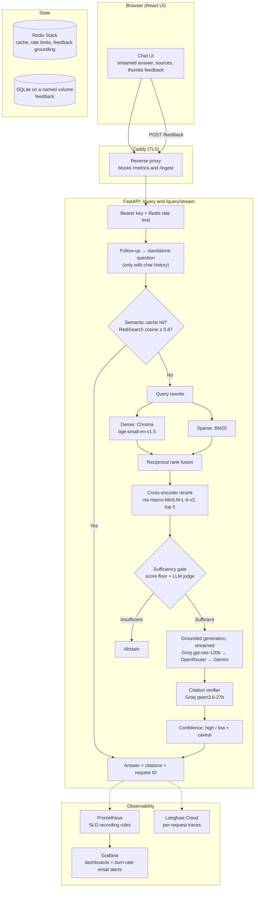

# Personal Knowledge OS — Production RAG System

[](https://github.com/yashbhosale789/Personal-Knowledge-RAG/actions/workflows/tests.yml)
[](https://github.com/yashbhosale789/Personal-Knowledge-RAG/actions/workflows/frontend.yml)
[](https://github.com/yashbhosale789/Personal-Knowledge-RAG/actions/workflows/uptime.yml)
[](https://www.python.org/)
[](LICENSE)

A single-user **Retrieval-Augmented Generation** system that answers questions about a personal document collection with grounded, cited answers, and abstains when the documents do not support an answer. It runs live on a 2 GiB AWS EC2 instance on a $0 budget, with CI/CD, an evaluation harness, tracing, SLOs and alerting.

The focus is engineering discipline around a RAG pipeline rather than model novelty: every quality claim is measured on a versioned dataset, every request can be traced end to end, and every known defect is pinned by a failing test until it is fixed.

**Live:** [yash-pkb-rag.duckdns.org](https://yash-pkb-rag.duckdns.org). The UI asks for the API key; this is a single-user system with one shared key, so the public link shows the UI but not answers.

<!-- TODO: add a short demo GIF of a question, a streamed answer with sources, and thumbs feedback. -->

**Status:** Phases 1–14 are closed (pipeline, deployment, LLMOps, feedback and React UI). Phase 15 (ingestion correctness and the full corpus) is next. See [Known limitations](#known-limitations) and the [roadmap](docs/architecture/roadmap.md).

---

## Architecture



Ingestion: PDF, Markdown, DOCX and TXT → recursive character chunker (512 characters, 64 overlap) → embeddings into Chroma, plus `storage/chunks.json` for BM25. The production index is currently built into the image (see [Known limitations](#known-limitations)).

---

## What it does

**Retrieval and answer quality**
- Hybrid retrieval: dense (Chroma, `BAAI/bge-small-en-v1.5`) and BM25, merged with reciprocal rank fusion and reranked by a cross-encoder.
- A sufficiency gate (cross-encoder score floor, then an LLM judge) abstains before generation when the evidence is missing.
- Answers cite `[SOURCE N]`. A second model from a different family checks that each claim is supported; unsupported answers are marked low-confidence with a caveat.
- Chat memory: the UI sends the last five turns, and a follow-up ("what about the SUV?") is rewritten into a standalone question before the cache and retrieval see it.

**Serving**
- `/query` (JSON) and `/query/stream` (server-sent events: tokens, then one final event with verification, confidence and per-chunk sources).
- Provider retry and fallback (Groq → OpenRouter → Gemini; Ollama for local use). On the stream, fallback happens only before the first token.
- Redis semantic cache, namespaced by prompt version and model, so a prompt or model change never serves an old answer.
- `POST /feedback`: thumbs up/down and an optional comment, stored in SQLite with the prompt version, model, and the source, page and snippet of each chunk used (not just chunk IDs). Text is deleted after 90 days.

**Front end**
- React + TypeScript (Vite), served by FastAPI from the same origin as the API. Plain-text rendering and a Content-Security-Policy that allows only same-origin scripts and requests; the API key lives in `sessionStorage` only.

**Observability and operations**
- One request ID across the response, JSON logs, Prometheus metrics and the Langfuse trace.
- Per-stage latency and per-LLM-stage token accounting (`rewrite`, `sufficiency`, `generate`, `citation_verify`), marked reported or estimated.
- Provisional SLOs (99% non-5xx and 95% of `/query` within 10 s, over 28 days) with fast- and slow-burn alerts by email, plus app-down, provider-failure and fallback-rate alerts. All were fire-tested.
- External uptime check every 10 minutes from GitHub Actions.
- Container memory limits, Redis `maxmemory`, Docker log rotation, and a documented logging and retention policy.

**Security**
- Bearer key (fails closed), Redis rate limits, HTTPS via Caddy, `/metrics` and `/ingest` not reachable from the internet.
- Prompt-injection scanning on API ingestion; retrieved text, chat history and feedback comments are treated as untrusted.
- `bandit`, `ruff`, `pip-audit`, Dependabot and CodeQL in CI. One incident (committed keys, 2026-10-29) is written up in the roadmap, with its fixes.

---

## Evaluation

All numbers: corpus `c1` (5 PDF car manuals, 40 chunks), dataset `v1` (57 questions: 45 dev, 12 frozen test), prompt version `938331ced9a6`. The judge is calibrated against hand-labelled good and bad answers (n = 20 per metric, AUC 1.0 for faithfulness, correctness and relevancy).

**Retrieval** (37 answerable dev questions, no LLM calls):

| Stage | Recall@5 | MRR |
| --- | --- | --- |
| Dense | 0.946 | 0.769 |
| BM25 | 0.784 | 0.677 |
| Fused (RRF) | 0.932 | 0.741 |
| Reranked | 0.919 | **0.802** |

The reranker improves ranking (MRR) but not recall here, and on a 40-chunk corpus most differences are not statistically distinguishable. Re-measuring on the full corpus is Phase 15.1.

**End to end** (failure analysis, [report](docs/architecture/eval-failure-analysis-2026-10-28.md)): 34 of 45 dev questions are fully correct. All 8 questions that should abstain did abstain, so no answer was given without support. The largest failure group is over-abstention (4), then ranking (2), retrieval misses (2) and incomplete answers (2).

**CI gate:** an LLM-judge regression gate on 4 CI questions (faithfulness ≥ 0.85, relevancy ≥ 0.75) runs on pipeline changes and weekly. It reports rather than blocks when free-tier rate limits cut a run short.

Run it locally (from `rag-project/`):

```powershell
python -m eval.tools.validate_dataset      # dataset schema and evidence spans
python -m eval.harness.retrieval_eval      # retrieval metrics, no LLM calls
python -m eval.harness.generate            # answers for the golden dataset
python -m eval.harness.judge               # LLM-judge scores
python -m eval.harness.gate                # regression gate
python -m eval.security.injection_eval     # prompt-injection resistance
```

---

## Production deployment

- **Host:** one AWS EC2 `t3.small` (2 GiB) running Caddy, the app, Redis Stack, Prometheus and Grafana in Docker Compose, each with a memory limit.
- **CD:** a merge to `main` that touches the app builds the image (UI included), pushes it to GHCR, and runs `rag-project/deploy.sh` on the instance through AWS Systems Manager, so no SSH port is open.
- **Deploy script:** pulls the image, recreates only the app container and waits for it to be healthy, then clears the semantic cache and sends a warm-up query. If the new version is unhealthy, it redeploys the previous image automatically. Rollback has been drilled on production.
- **Secrets:** GitHub OIDC is blocked by the account's managed policy, so deploys use a least-privilege key rotated every 90 days.

---

## Known limitations

These are deliberate, tracked in the [roadmap](docs/architecture/roadmap.md), and each is pinned by a strict `xfail` test where it is a code defect:

- **Small corpus.** Production serves 5 PDFs (`c1`). The full corpus (about 1,190 files) and its formats arrive in Phase 15.1.
- **Ingestion is not yet consistent.** BM25 is built from `chunks.json`, so documents ingested through the API never reach keyword search and deleted ones can still be retrieved. API ingest is therefore disabled in production, and the index is built into the image. Fixed in Phase 15.0.
- **Single user.** One shared key; every key holder sees the whole corpus and shares one cache.
- **Provisional SLOs.** Single-user traffic is too sparse to tune them; no load test yet (Phase 15.4).
- **Free tiers.** Generation and verification both use Groq's free tier; the verifier degrades to a low-confidence, uncached answer if it fails.

---

## Local setup

**Prerequisites:** Python 3.11, Docker, Node 22 (only for UI development), and a Groq API key (or Ollama for fully local use).

```powershell
cd rag-project
python -m venv .venv
.\.venv\Scripts\Activate.ps1
python -m pip install -r requirements-local.txt -r requirements-dev.txt   # CUDA 12.4 torch; see requirements.in for CPU
```

Create `rag-project/.env`:

```dotenv
API_KEY=a-long-random-token
PIPELINE_PROVIDER=groq
GROQ_API_KEY=your-groq-api-key
EVAL_PROVIDER=groq
REDIS_HOST=localhost
REDIS_PORT=6379
```

Start Redis, build the index, and run the API:

```powershell
docker compose up -d redis
python scripts/ingest.py                         # documents in data/documents/
uvicorn api.main:app --reload --port 8000
```

UI development (proxies `/query` and `/feedback` to port 8000):

```powershell
cd frontend
npm ci
npm run dev
```

Tests: `pytest -m "not slow"` from `rag-project/` (offline, no model downloads).

---

## API

The query, feedback and ingest endpoints need `Authorization: Bearer <API_KEY>`.

**`POST /query`**

```bash
curl -X POST http://127.0.0.1:8000/query \
  -H "Authorization: Bearer $API_KEY" \
  -H "Content-Type: application/json" \
  -d '{"query": "Where is the spare tyre on the Aventro Sedan?"}'
```

The response (schema pinned by `tests/contracts/query_response.json`) carries `query_id`, `answer`, `sources`, `rewritten_query`, `sufficiency`, `citation_check`, `confidence` (`high` / `low`), `outcome` (`answer`, `answer_low_confidence`, `abstain`, `empty`), `prompt_version` and `latency_ms`. An optional `history` (up to 5 earlier turns) makes the query a follow-up.

**`POST /query/stream`:** same body; server-sent `token` events, then one `final` event (`tests/contracts/query_stream_final.json`) or one `error`.

**`POST /feedback`:** `{"request_id": "...", "rating": "up" | "down", "comment": "optional"}`.

**`POST /ingest`, `DELETE /ingest`:** local development only until Phase 15.0.

**`GET /health`, `GET /metrics`:** health check and Prometheus metrics (`/metrics` is not exposed publicly).

---

## Repository layout

```text
rag-project/
├── api/                  FastAPI app: routers (query, stream, feedback, ingest, health), auth, middleware
├── src/                  Pipeline: ingestion, embedding, retrieval, llm (providers, cache, usage), pipeline stages
├── frontend/             React + TypeScript UI (Vite, Vitest, Playwright)
├── eval/                 Golden dataset, harness (retrieval, generate, judge, gate), security evals
├── tests/                Unit, API, contract, integration, Redis and slow suites
├── grafana/              Provisioned dashboard, datasource and alert rules
├── prometheus-rules.yml  SLO recording rules
├── docker-compose*.yml   Local and production stacks
├── deploy.sh             Deploy and rollback script (ships in the image)
└── Dockerfile            UI build stage + Python app
docs/                     Architecture, roadmap, runbooks, engineering and security docs
.github/workflows/        Tests, Code Quality, Dependency Audit, Frontend, Eval Regression Gate, Build and Push Image, Uptime
```

---

## Documentation

- [Roadmap and phase records](docs/architecture/roadmap.md): what was built, how it was verified, and the decisions behind it
- [Eval failure analysis](docs/architecture/eval-failure-analysis-2026-10-28.md)
- [System context](docs/architecture/system-context.md)
- [Documentation hub](docs/README.md) and [engineering templates](docs/templates/README.md)
- [Project memory](docs/context/Memory.md): durable decisions and lessons
- [Security policy](SECURITY.md) · [Contributing](CONTRIBUTING.md) · [Changelog](CHANGELOG.md)

---

## License

Apache License 2.0. See [LICENSE](LICENSE).
