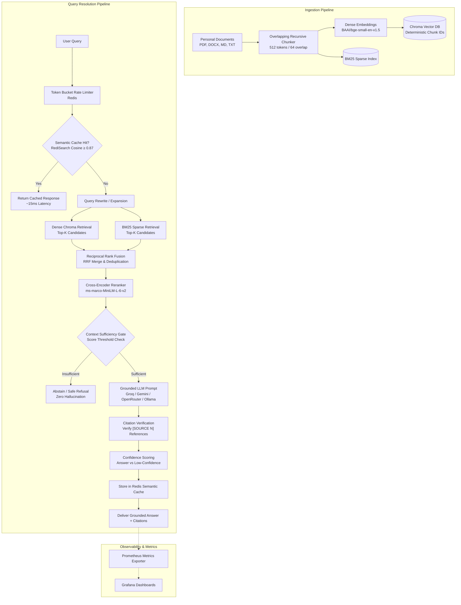

# Personal Knowledge OS — Production RAG System

[](https://www.python.org/)
[](https://fastapi.tiangolo.com/)
[](https://www.trychroma.com/)
[](https://redis.io/)
[](https://github.com/)
[](https://aws.amazon.com/)
[](LICENSE)

An enterprise-informed, production-grade **Retrieval-Augmented Generation (RAG)** platform designed to ingest personal and organizational knowledge bases (PDFs, Markdown, DOCX, TXT) and provide strictly grounded, verifiable, and observable answers.

The system combines local dense embeddings and sparse keyword retrieval with reciprocal rank fusion (RRF), cross-encoder reranking, context sufficiency gating, citation verification, Redis-backed semantic caching, Prometheus observability, and automated CI/CD evaluation regression gates.

---

## Architecture Overview



---

## Key Engineering Capabilities

* **Hybrid Retrieval & Reranking:** Fuses dense vector similarity (`BAAI/bge-small-en-v1.5`) with sparse lexical matching (`BM25`) using Reciprocal Rank Fusion (RRF), followed by a high-precision cross-encoder reranker (`cross-encoder/ms-marco-MiniLM-L-6-v2`).
* **Hallucination & Abstention Defense:**
  * **Context Sufficiency Gate:** Evaluates whether retrieved chunks contain sufficient evidence *before* invoking generative LLMs, refusing to hallucinate on missing context.
  * **Citation Verification:** Enforces inline citation tags (`[SOURCE N]`) in generation prompts and automatically verifies claims against source chunk indices.
  * **Deterministic Chunk IDs:** Hashes source file paths and chunk offsets to prevent chunk duplication and ensure idempotent re-ingestion.
* **Resilient Multi-Provider LLM Engine:** Supports Groq (Llama 3.3/3.1), Google Gemini, OpenRouter, and local Ollama instances with automated retry, exponential backoff, and transparent cross-provider fallback.
* **Low-Latency Semantic Caching:** Integrated Redis Stack and RediSearch vector indexes compute cosine similarity against prior queries, serving semantic cache hits with sub-20ms latency.
* **Enterprise CI/CD Eval Regression Gate:** Automated GitHub Actions workflows evaluate a golden evaluation dataset on every PR using LLM-as-a-judge and Ragas metrics, blocking regressions in faithfulness or answer relevance.
* **Telemetry & Security:**
  * Prometheus exposition (`/metrics`) tracking stage latencies, token consumption, cache hit rates, and error rates.
  * Prompt injection detection filters on document ingestion.
  * Static security analysis via `bandit` and linting via `ruff` in CI.

---

## Repository Structure

```text
Personal Knowledge OS (RAG System)/
├── rag-project/                  # Core RAG Application & Backend Engine
│   ├── api/                      # FastAPI endpoints (/query, /ingest, /health, /metrics), auth, middleware
│   ├── src/                      # Production Pipeline Source Code
│   │   ├── embedding/            # Sentence-transformer embedding adapters
│   │   ├── ingestion/            # File loaders (PDF, MD, DOCX, TXT) & chunkers
│   │   ├── llm/                  # Provider clients, fallback, semantic cache, rate limiter
│   │   ├── pipeline/             # Advanced RAG stages, sufficiency & citation gates
│   │   ├── retrieval/            # Dense, BM25, RRF fusion, and cross-encoder reranking
│   │   └── vectorstore/          # Chroma vector store persistence layer
│   ├── eval/                     # Evaluation harness (generate, judge, gate), golden dataset, security evals
│   ├── scripts/                  # CLI utilities (ingest, interactive query, inspect embeddings)
│   ├── tests/                    # Unit, component, and pipeline integration test suites
│   ├── docker-compose.yml        # Multi-container orchestration (App, Redis, Prometheus, Grafana)
│   └── Dockerfile                # Production container specification
│
├── docs/                         # Centralized Documentation & Architecture Hub
│   ├── README.md                 # Documentation Index & Architecture Map
│   ├── context/                  # Core AI Project Context Files (Claude & System Grounding)
│   │   ├── Architecture.md       # Target architecture, grounding rules, and production DoD
│   │   ├── Roadmap.md            # Detailed phase roadmap (Phases 1–12 closed, Phase 13 active)
│   │   ├── Memory.md             # Consolidated durable project memory & verified facts
│   │   └── Ponytail.md           # Senior lazy developer discipline (YAGNI, root cause, minimal diff)
│   ├── architecture/             # High-level system architecture and roadmap
│   │   ├── system-context.md     # Engineering principles, target architecture, quality metrics
│   │   └── roadmap.md            # Master 21-phase evolution plan (Current: Phase 13)
│   ├── runbooks/                 # Infrastructure operations & command guides
│   │   └── redis-stack-guide.md  # Redis Stack CLI, semantic cache lifecycle, RediSearch
│   ├── templates/                # Standardized engineering specifications & runbooks
│   │   ├── development/          # API, Coding Standards, Configuration, Vector Store, Local Dev
│   │   ├── engineering/          # Testing, Evaluation, Observability, Performance, Error Handling
│   │   ├── operations/           # Deployment, CI/CD, Rollback, Runbooks, Cost Management
│   │   └── security/             # Threat Model, Security Posture, Secrets, Privacy, Incident Response
│   └── archive/                  # Historical phase reports (Phases 1–4) & learning journals
│
├── prompts/                      # Developer & AI Assistant Collaboration Workflows
│   ├── README.md                 # Workflow guidelines & context usage
│   └── workflows/                # Standardized prompts (Session Startup, Memory Update, Review)
│
├── deploy/                       # Cloud VM Deployment
│   └── deploy.sh                 # AWS SSM automated pull-and-deploy script
│
├── postman/ & .postman/          # API Testing & Postman CLI Configuration
│   ├── collections/              # Dev and Prod query/ingest test collections
│   └── environments/             # Environment variable definitions
│
├── .github/workflows/            # CI/CD Automation Workflows
│   ├── eval-gate.yml             # Pull-request evaluation regression gate
│   ├── code-review.yml           # Static analysis (ruff linting + bandit security scan)
│   └── build-push.yml            # Docker build, push to GHCR, and AWS SSM auto-deploy
│
├── .gitignore                    # Environment, storage, and build exclusion rules
├── LICENSE                       # Apache 2.0 Open Source License
└── SECURITY.md                   # Security vulnerability disclosure policy
```

---

## Quickstart & Local Setup

### 1. Prerequisites

- **Python:** Version `3.11`
- **Docker:** Docker Desktop or Engine with Docker Compose
- **Redis Stack:** For semantic caching and rate limiting (`redis/redis-stack:latest`)
- **GPU (Optional):** NVIDIA CUDA 12.4 support (falls back to CPU automatically)

### 2. Environment Configuration

Navigate to [`rag-project/`](rag-project) and configure an isolated virtual environment:

```powershell
cd rag-project
python -m venv .venv
.\.venv\Scripts\Activate.ps1
python -m pip install --upgrade pip
python -m pip install --extra-index-url https://download.pytorch.org/whl/cu124 -r requirements.txt
```

Create a local `.env` configuration file inside `rag-project/`:

```dotenv
API_KEY=your-secure-bearer-token
PIPELINE_PROVIDER=groq
GROQ_API_KEY=your-groq-api-key
EVAL_PROVIDER=groq
AGENT_PROVIDER=groq
REDIS_HOST=localhost
REDIS_PORT=6379
```

### 3. Start Supporting Infrastructure

Run Redis Stack in Docker:

```powershell
docker run -d --name redis-stack -p 6379:6379 -p 8001:8001 redis/redis-stack:latest
docker exec -it redis-stack redis-cli ping
```

### 4. Ingest Documents

Place your source documents (PDF, Markdown, DOCX, TXT) into `rag-project/data/documents/` and execute the ingestion script:

```powershell
python scripts/ingest.py
```

### 5. Launch the Application Service

**FastAPI Direct (Local Dev):**

```powershell
uvicorn api.main:app --reload --host 127.0.0.1 --port 8000
```

**Docker Compose (Full Stack with Prometheus & Grafana):**

```powershell
docker compose up --build
```

---

## API Usage Reference

Protected endpoints require the `Authorization: Bearer <API_KEY>` header.

### 1. Query the Knowledge Base (`POST /query`)

```bash
curl -X POST http://127.0.0.1:8000/query \
  -H "Authorization: Bearer <API_KEY>" \
  -H "Content-Type: application/json" \
  -d '{
    "query": "How do I perform maintenance on the braking system?",
    "provider": "groq",
    "return_contexts": true
  }'
```

**Example JSON Response:**

```json
{
  "query": "How do I perform maintenance on the braking system?",
  "rewritten_query": "vehicle braking system maintenance inspection procedure",
  "answer": "To perform maintenance on the braking system, first inspect the brake pad thickness [SOURCE 1]. If the pad lining is under 3mm, replace the pads immediately [SOURCE 2].",
  "sources": ["vehicle_manual.pdf"],
  "chunks_used": 2,
  "provider": "groq",
  "latency": 0.42,
  "sufficiency": {
    "is_sufficient": true,
    "verdict": "sufficient",
    "reasoning": "Retrieved context directly specifies pad inspection criteria."
  },
  "citation_check": {
    "all_citations_valid": true,
    "valid_citations": [1, 2],
    "invalid_citations": []
  },
  "confidence": "high",
  "outcome": "answer"
}
```

### 2. Ingest Document via API (`POST /ingest`)

```bash
curl -X POST http://127.0.0.1:8000/ingest \
  -H "Authorization: Bearer <API_KEY>" \
  -H "Content-Type: application/json" \
  -d '{
    "file_path": "data/documents/manual.pdf",
    "force_reingest": false
  }'
```

### 3. Health & Telemetry (`GET /health`, `GET /metrics`)

```bash
curl http://127.0.0.1:8000/health
curl http://127.0.0.1:8000/metrics
```

---

## Production Cloud Deployment (AWS EC2)

The system is deployed live to AWS infrastructure following strict $0-budget and high-reliability design patterns:

* **Live Demo:** Deployed to AWS EC2 with automated SSL/TLS via Caddy reverse proxy.
* **Infrastructure:** 2 GB `t3.small` EC2 instance (Ubuntu 24.04 LTS) running containerized services (FastAPI app, Redis Stack, Prometheus, Caddy).
* **Automated Reverse Proxy & TLS:** Caddy automatically issues and renews Let's Encrypt SSL/TLS certificates.
* **Zero-Downtime Continuous Deployment (CD):**
  * Qualifying merges to `main` trigger `.github/workflows/build-push.yml`, which builds and pushes the container image to GitHub Container Registry (GHCR).
  * AWS Systems Manager (SSM) Run Command executes `deploy/deploy.sh` remotely on the instance without requiring open public SSH ports.
  * The deployment script verifies the image pull, switches the container, flushes the Redis semantic cache, executes a warm-up `/query`, and verifies health.
  * **Automated Rollback:** If the new image fails health verification, the script automatically rolls back to the previous stable `.prev_image_tag`.

---

## Automated Evaluation & Quality Engineering

The system treats RAG quality as a first-class engineering discipline:

| Metric                        | Target       | Evaluation Mechanism                                                         |
| :---------------------------- | :----------- | :--------------------------------------------------------------------------- |
| **Faithfulness**        | $\ge 0.85$ | Verifies that all generated claims are grounded in retrieved source context. |
| **Answer Relevance**    | $\ge 0.80$ | Verifies that the answer directly addresses the original query.              |
| **Context Sufficiency** | Gated        | Rejects unanswerable queries before calling the generative LLM.              |
| **Citation Validity**   | $100\%$    | Validates that emitted `[SOURCE N]` brackets correspond to true indices.   |

To execute the offline evaluation suite:

```powershell
# Run from rag-project/. Validate the golden dataset against the ingested chunks
python -m eval.tools.validate_dataset

# Run the pipeline against the golden evaluation dataset
python -m eval.harness.generate

# Score the answers with the LLM judge
python -m eval.harness.judge

# Verify quality against the regression gate thresholds
python -m eval.harness.gate

# Evaluate resistance to document-based prompt injection
python -m eval.security.injection_eval
```

---

## Project Evolution & Roadmap

This project is developed according to a comprehensive **21-Phase Production Blueprint**:

- [x] **Phase 1–5 (Done):** Naive RAG $\rightarrow$ Advanced RAG (BM25 + RRF + Reranker) $\rightarrow$ Evaluation Framework $\rightarrow$ Agentic RAG $\rightarrow$ FastAPI Backend.
- [x] **Phase 6–10 (Done):** Local LLMs (Ollama) $\rightarrow$ Prometheus Observability $\rightarrow$ RAG Quality Gates (Sufficiency & Citations) $\rightarrow$ Redis Security & Semantic Caching $\rightarrow$ Containerization & CI/CD Eval Gate.
- [x] **Phase 11 (Done):** Pre-Deployment Hardening, Ruff/Bandit static security gates, vector store idempotent upsert audit.
- [x] **Phase 12 (Done):** Cloud Deployment on AWS (EC2), Caddy reverse proxy, zero-downtime automated deployment via GitHub Actions & AWS SSM.
- [ ] **Phase 13 (Current / In Progress):** LLMOps (Langfuse self-hosted tracing & cost metrics, prompt versioning, cross-encoder reranker comparison experiments, human feedback endpoint).
- [ ] **Phase 14–16:** Graph RAG + Multimodal $\rightarrow$ Portfolio Extraction $\rightarrow$ React Streaming UI.
- [ ] **Phase 17–21:** Kafka Event-Driven Ingestion $\rightarrow$ Kubernetes Orchestration $\rightarrow$ Multi-Agent Collaboration $\rightarrow$ Quantization / MoE Fine-tuning.

For the detailed phase plan and architecture decisions, see [`docs/architecture/roadmap.md`](<file:///D:/Development/GenAI/Personal%20Knowledge%20OS%20(RAG%20System)/docs/architecture/roadmap.md>).

---

## Documentation Index

Explore our comprehensive engineering documentation:

- 📖 [**Documentation Hub**](<file:///D:/Development/GenAI/Personal%20Knowledge%20OS%20(RAG%20System)/docs/README.md>)
- 🧠 [**AI Project Context Hub**](<file:///D:/Development/GenAI/Personal%20Knowledge%20OS%20(RAG%20System)/docs/context/Architecture.md>) — [Architecture](<file:///D:/Development/GenAI/Personal%20Knowledge%20OS%20(RAG%20System)/docs/context/Architecture.md>), [Roadmap](<file:///D:/Development/GenAI/Personal%20Knowledge%20OS%20(RAG%20System)/docs/context/Roadmap.md>), [Memory](<file:///D:/Development/GenAI/Personal%20Knowledge%20OS%20(RAG%20System)/docs/context/Memory.md>), and [Ponytail](<file:///D:/Development/GenAI/Personal%20Knowledge%20OS%20(RAG%20System)/docs/context/Ponytail.md>)
- 📐 [**System Context & Architecture Target**](<file:///D:/Development/GenAI/Personal%20Knowledge%20OS%20(RAG%20System)/docs/architecture/system-context.md>)
- 🗺️ [**Project Roadmap**](<file:///D:/Development/GenAI/Personal%20Knowledge%20OS%20(RAG%20System)/docs/architecture/roadmap.md>)
- 🛠️ [**Redis Stack Runbook**](<file:///D:/Development/GenAI/Personal%20Knowledge%20OS%20(RAG%20System)/docs/runbooks/redis-stack-guide.md>)
- 📋 [**Engineering Scaffolding Templates**](<file:///D:/Development/GenAI/Personal%20Knowledge%20OS%20(RAG%20System)/docs/templates/README.md>)
- 🤖 [**AI Collaboration Workflows**](<file:///D:/Development/GenAI/Personal%20Knowledge%20OS%20(RAG%20System)/prompts/README.md>)

---

## License

This project is licensed under the Apache License 2.0. See [LICENSE](LICENSE) for details.
