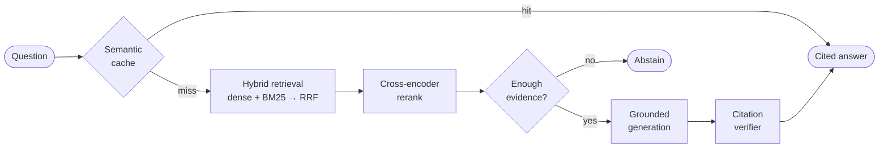

<div align="center">

# Personal Knowledge OS

**Ask your documents. Get a cited answer, or an honest "the documents don't say".**

[](https://github.com/yashbhosale789/Personal-Knowledge-RAG/actions/workflows/tests.yml)
[](https://github.com/yashbhosale789/Personal-Knowledge-RAG/actions/workflows/frontend.yml)
[](https://github.com/yashbhosale789/Personal-Knowledge-RAG/actions/workflows/uptime.yml)
[](https://www.python.org/)
[](LICENSE)

[Live demo](https://yash-pkb-rag.duckdns.org) · [Architecture](ARCHITECTURE.md) · [Evaluation](EVALUATION.md) · [API](API.md) · [Run it locally](DEVELOPMENT.md)

</div>

A production **Retrieval-Augmented Generation** system for a personal document collection. It answers with citations it has checked, and it abstains when the evidence isn't there. It runs live on a 2 GiB AWS instance on a $0 budget, with CI/CD, an evaluation harness, tracing, SLOs and alerting.

The focus is engineering discipline rather than model novelty: every quality claim is measured on a versioned dataset, every request can be traced end to end, and every known defect is pinned by a failing test until it is fixed.

<!-- TODO: add a short demo GIF of a question, a streamed answer with sources, and thumbs feedback. -->

---

## Highlights

- **Grounded or silent.** A sufficiency gate stops generation when the retrieved evidence can't support an answer. In evaluation, all 8 questions that should abstain did.
- **Citations that are checked.** Every answer cites `[SOURCE N]`, and a second model from a different family verifies each claim. An unsupported answer is flagged low-confidence.
- **Hybrid retrieval.** Dense vectors and BM25, fused with reciprocal rank fusion and reranked by a cross-encoder.
- **Measured, not claimed.** Versioned corpora and datasets, paired comparisons with confidence intervals, and an LLM-judge regression gate in CI.
- **Observable end to end.** One request ID ties together the response, logs, metrics and trace. SLOs have burn-rate email alerts.
- **Shipped and operated.** Every merge deploys through AWS Systems Manager, with health checks and automatic rollback. Uploaded documents survive deploys.

## How it works



Documents go in through the UI (PDF upload) or a batch script. Both use one ingest path: injection scan, chunk, embed, store, then invalidate the cache and the keyword index. The full system, ingestion, delivery and design decisions are in **[ARCHITECTURE.md](ARCHITECTURE.md)**.

## Results

| | 5-PDF corpus (`c1`, production) | 236-PDF corpus (`c2`) |
| --- | --- | --- |
| Reranked recall@5 | **0.90** | **0.81** |
| Reranked MRR | 0.82 | 0.72 |
| Correct abstentions (dev) | 8 / 8 | — |
| Fully correct answers (dev) | 34 / 45 | — |

On `c2`, retrieval tuning found a configuration with distinguishably better ranking (MRR 0.72 → 0.83 on dev). Method, confidence intervals and every experiment: **[EVALUATION.md](EVALUATION.md)**.

## Tech stack

| Layer | Built with |
| --- | --- |
| Retrieval | ChromaDB, `BAAI/bge-small-en-v1.5`, BM25 (`rank-bm25`), `ms-marco-MiniLM-L-6-v2` cross-encoder |
| Generation | Groq `gpt-oss-120b` → OpenRouter → Gemini fallback, Groq `qwen3.8-27b` verifier, Ollama locally |
| Serving | FastAPI, server-sent events, Redis Stack (semantic cache, rate limits), SQLite (feedback) |
| Front end | React 19, TypeScript, Vite, Vitest, Playwright |
| Operations | Docker Compose, Caddy, AWS EC2 + Systems Manager, GHCR, GitHub Actions |
| Observability | Prometheus, Grafana, Langfuse |

## Quick start

```powershell
cd rag-project
python -m venv .venv; .\.venv\Scripts\Activate.ps1
python -m pip install -r requirements-local.txt -r requirements-dev.txt
copy .env.sample .env                      # then set API_KEY and GROQ_API_KEY
docker compose up -d redis
python scripts/ingest.py
uvicorn api.main:app --reload --port 8000
```

Then ask a question:

```bash
curl -X POST http://127.0.0.1:8000/query -H "Authorization: Bearer $API_KEY" \
  -H "Content-Type: application/json" -d '{"query": "Where is the spare tyre on the Aventro Sedan?"}'
```

UI, tests, corpora and tooling: **[DEVELOPMENT.md](DEVELOPMENT.md)**.

## Documentation

| Read | For |
| --- | --- |
| [ARCHITECTURE.md](ARCHITECTURE.md) | System, query and ingestion diagrams, components, storage, design decisions, limitations |
| [EVALUATION.md](EVALUATION.md) | Datasets, retrieval and end-to-end results, tuning experiments, CI gate |
| [API.md](API.md) | Every endpoint with examples, fields and error codes |
| [OPERATIONS.md](OPERATIONS.md) | Deployment, rollback, SLOs, alerts, backups, secrets, cost |
| [DEVELOPMENT.md](DEVELOPMENT.md) | Local setup, tests, CI workflows, scripts and tools |
| [Roadmap](docs/architecture/roadmap.md) | What was built in each phase, how it was verified, and what's next |
| [SECURITY.md](SECURITY.md) · [CONTRIBUTING.md](CONTRIBUTING.md) · [CHANGELOG.md](CHANGELOG.md) | Reporting vulnerabilities, contributing, release history |

## Status

Phases 1–14 are done (pipeline, deployment, LLMOps, feedback and React UI), as are 15.0 (one consistent ingest path and PDF upload) and 15.1 (the full corpus, evaluated offline). Phase 15.2 (retrieval tuning and stage ablations) is in progress. It is a single-user system; [known limitations](ARCHITECTURE.md#known-limitations) are listed openly.

The live demo asks for the API key. This is a single-user system with one shared key, so the public link shows the UI but not answers.

## License

Apache License 2.0. See [LICENSE](LICENSE).
